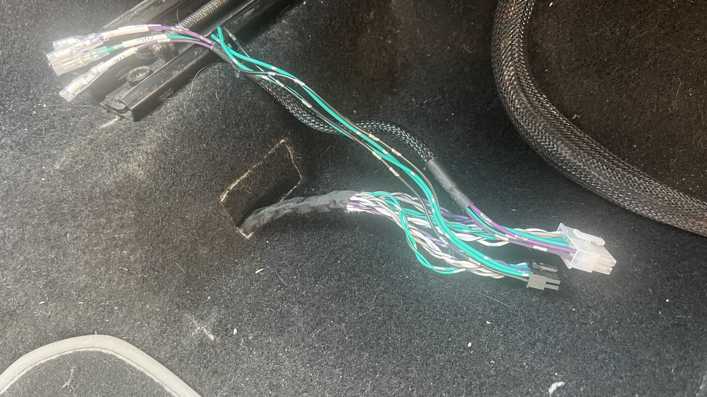
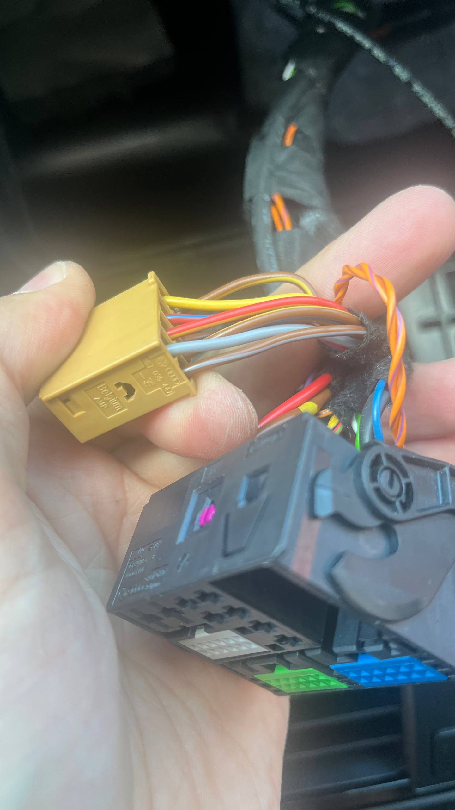
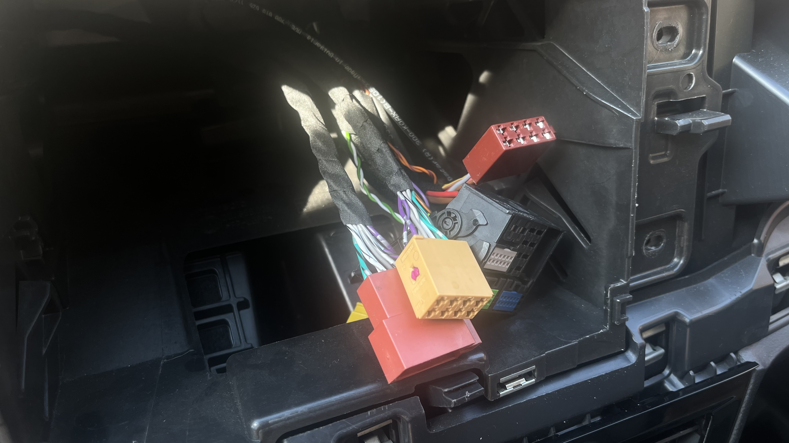
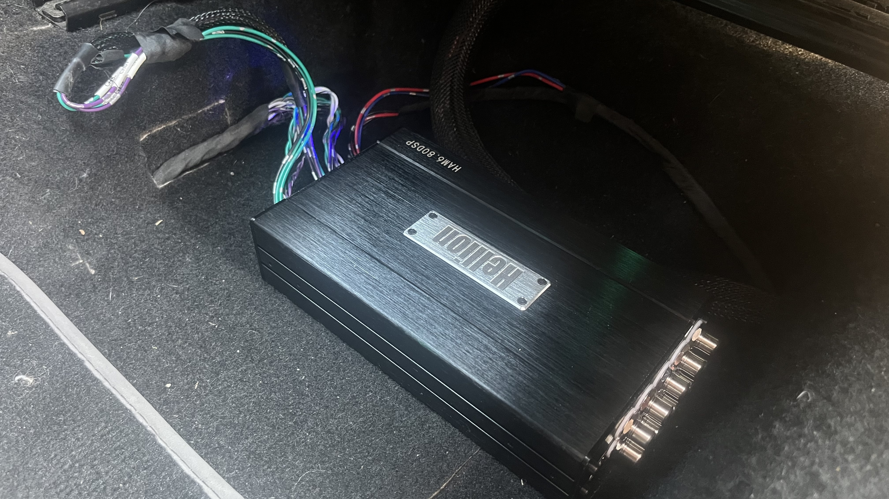
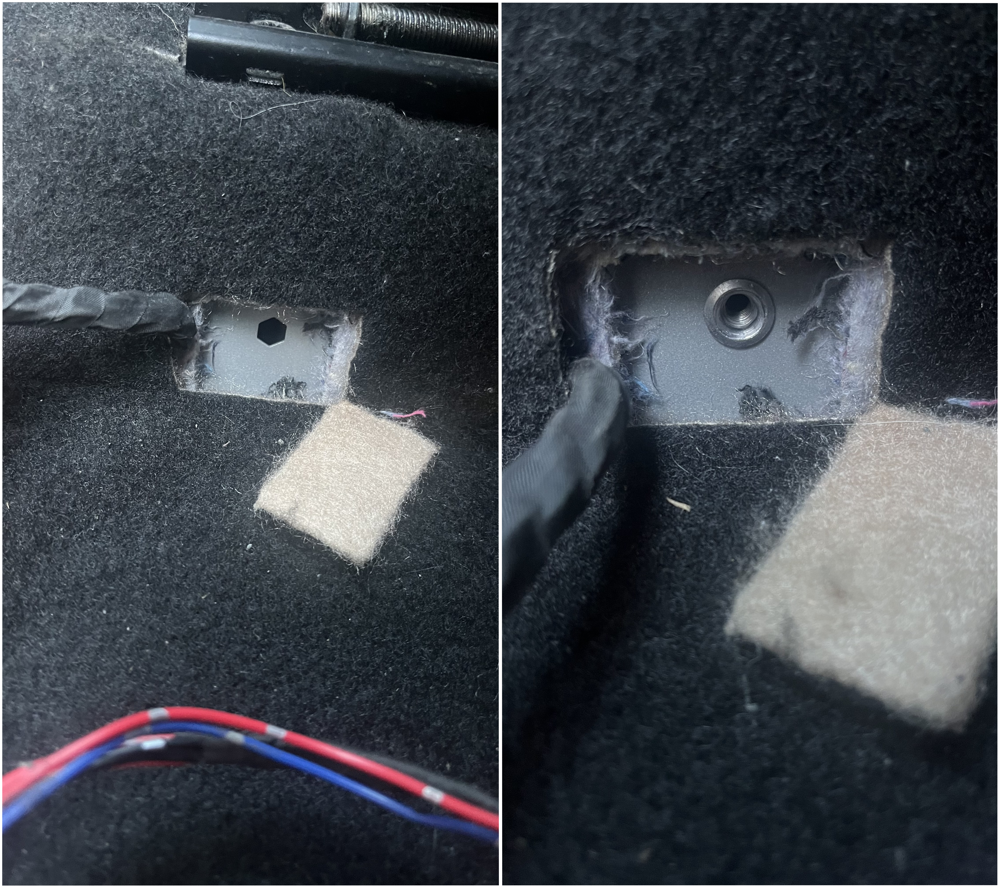
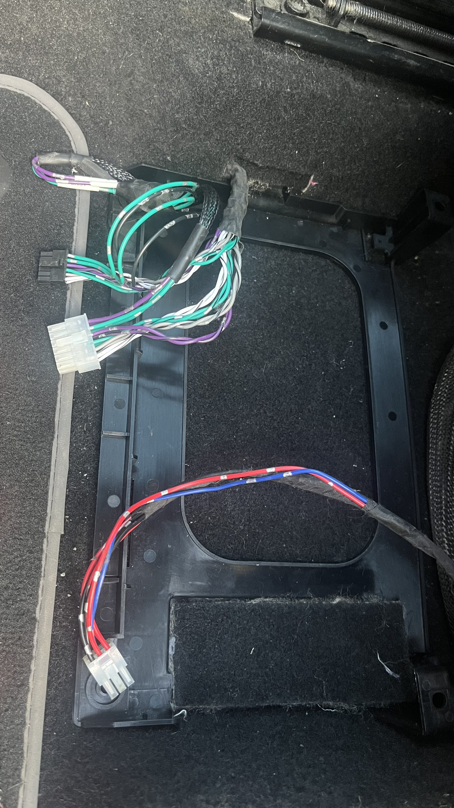
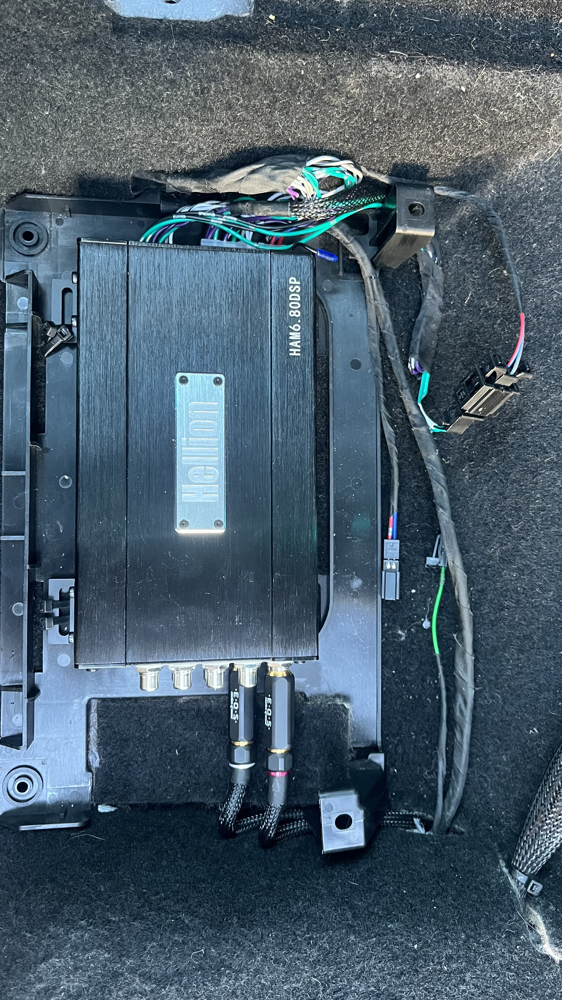
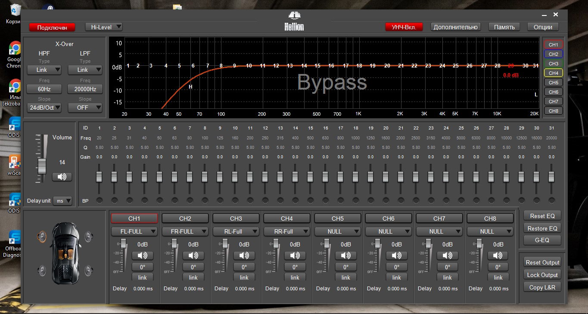

  
Получить более хорошего звучания и громкости от музыки в машине хотелось давно. Вариант установки Beats Audio, как это сделал DanceNation замечательный,
но сбор всех комплектующих и их установка, а далее кодирование - меня утомляло.  
Где-то наткнулся на вариант установки проце-уся (процессора-усилителя), начал более детально в это вникать. Посоветовавшись с человеком 
из соседнего автоклуба по VAG, решено об установке Hellion HAM 6.80 DSP.  
  
<!-- more -->
Что нам понадобится:  
Hellion HAM 6.80 DSP — 1 шт.  
Hellion PTP 6.80 (Кабель для Pin-to-Pin подключения усилителя) – 1 шт.  
Кронштейн штатного усилителя под водительское сидение: _3QD907390_ - 1 шт.  
Заклепка M6 для крепления кронштейна - _N10618501_ – 1 шт.  
Гайка для крепления кронштейна  - _N01508210_ – 2 шт.  
Винт для крепления кронштейна - _N91079901_ - 1 шт.  
Разъем "папа" для подключение провода Remote - _8W0971832_ или _4B0971832_ - 1 шт.  
Пин для разъема "папа" - _N90764701_ - 1 шт.
Разъем "мама" для подключение провода Remote - _8W0972575_ - 1 шт.  
Пин для разъема "мама" - _61131383672_ - 1 шт.  
Клемма кольцевая М6 для массы - 1 шт.  
Клемма для блока предохранителей ________ - 1 шт.  
Провода разноколиберные сечением 0.5 или 0.75мм для провода Remote, тканевая изолента.  
  
## Установка
Hellion решил устанавливать в место, где штатно устанавливается усилитель.  
Разбираем накладку панели, снимаем ГУ. 
Теперь необходимо к этому месту протянуть жгут проводов Hellion PTP 6.80 от ГУ. Жгут проводил вдоль центральной консоли.
 
В разъеме Quadlock необходимо перепиновать разъем _3B7035447_ с ISO разъемом из жгута проводов _PTP 6.80_. 
 
Перепиновывать провода сами не нужно, пины отлично занимают место в другом разъеме. После перепиновки остается вставить разъем _3B7035447_ 
обратно в Quadlock и соединить между собой, ISO разъемы от жгута _PTP 6.80_. 
 
Ставим ГУ на место, собираем панель, здесь всё.  
Подключем питание Hellion'а. Минусовой провод наращиваем и подключаем к шпильке массы под порогом. Плюсовой провод также наращиваем 
и подключаем в блок предохранителей. Фото к сожалению пока нет. Кладём Hellion и подключаем к нему разъемы. Проверяем - все работает. 
Можно продолжить! 
 
В ковролине есть 2 окошка, в одном - отверстие для резьбовой заклепки, в другом - 2 шпильки. Устанавливаем резьбовую заклепку.  
 
Устанавливаем кронштейн усилителя на его место. Ковролин с окошек я не выбросил, а обратно их подсунул, не выпадывают.
 
Ранее была статья о переносе динамика ГЛОНАСС под бардачок - это было не просто так. Динамик под лобовым стеклом я подключил к Hellion'у, 
использовав разъемы, которые у меня остались от предыдущих доработок. Появился дополнительный источник звука, после предварительной настройки
динамик не перекрикивает. Провода Remote in и Remote out запиновал в разъем _8W0972575_. 
К Hellion'у прикрутил комплектные уголки-кронштейны. Одну сторону Hellion'а завёл под кронштейн, вторую сторону стянул пластиковыми стяжками.
Держится очень крепко.
Получился итоговый вариант такой:
 
Крышки нет, это не эстетично, но стоимость её слишком завышена по моему мнению.  
Ну и для ознакомления с возможностями Hellion'а:
 
После настройки процессора, звук стал лучше, громче. Появилась возможность к дальнейшему улучшению звука. Можно напрямую через Bluetooth подключиться
к процессору или вставить в него флешку и слушать музыку с неё.
  
[...вернуться на главную](/)